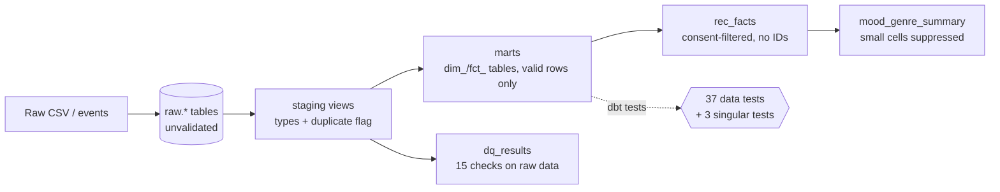

# dbt and Databricks layer

## What is verified and what is not
| Part | Status |
|---|---|
| dbt project on DuckDB (`dbt/`) | **Run and verified:** `dbt build` passes 53 of 53 steps (models, 37 tests, seed). Clean tables and aggregates match the SQLite pipeline exactly (`tests/test_dbt_parity.py`). |
| dbt on Databricks (`databricks` target in `dbt/profiles.yml`) | **Not run.** SQL was kept to constructs both DuckDB and Spark SQL support, but it has not been executed on Databricks. |
| `databricks/01_load_raw.py`, `02_privacy_delete.py`, `databricks.yml` | **Not run.** Written from documentation without a workspace. Treat as a starting point; run `databricks bundle validate` and check field names against current docs. |

## Architecture

On DuckDB, `raw.*` are the CSV files read in place. On Databricks they are Delta tables created by `01_load_raw.py`.

## How the earlier work maps to dbt
| Earlier (Python + SQLite) | Now (dbt) |
|---|---|
| `stg_*` tables loaded by pandas | `models/staging/` (typed views over `source('raw', ...)`) |
| 15 checks in `quality_checks.py` | `models/quality/dq_results.sql` (one table, same rules) |
| `build_clean.py` INSERT...SELECT | `models/marts/` (`dim_*`, `fct_*`) |
| SQLite CHECK/FK constraints | dbt tests in `_marts.yml` (unique, not_null, relationships, accepted_values, custom `between_values`) |
| `v_rec_facts` view | `models/analytics/rec_facts.sql` |
| `report.py` aggregates | `models/analytics/mood_genre_summary.sql` (`min_cell` variable) |
| pytest ground-truth test | `tests/dq_matches_injected_faults.sql` + `seeds/expected_faults.csv` (tag `synthetic_only`) |

## Run it
```bash
pip install -r requirements.txt -r requirements-dbt.txt
python run_pipeline.py                      # optional: builds the SQLite version for the parity test
cd dbt
dbt build --profiles-dir .                  # models + seed + tests
dbt build --profiles-dir . --exclude tag:synthetic_only   # what you would run on real data
dbt docs generate --profiles-dir . && dbt docs serve --profiles-dir .   # lineage graph
cd .. && pytest
```

## Databricks: what changes and why it matters for governance
1. **Constraints are no longer enforced by the database.** On Delta, NOT NULL and CHECK are enforced, but primary and foreign keys are informational only. dbt tests become the enforcement layer, and they run after the data is written, so a failing test must block downstream use (run `dbt build`, not `dbt run`).
2. **No ON DELETE CASCADE.** `02_privacy_delete.py` deletes children first, table by table.
3. **dbt rebuilds from raw.** If a deleted user remains in `raw.*`, the next build brings them back, so deletion has to cover raw tables too.
4. **Delta DELETE is logical.** Deleted rows stay readable through time travel until `VACUUM` removes the old files (default 7-day retention). Physical erasure is complete only after the window and a VACUUM, which should be stated in any deletion-request response and scheduled.
5. **Access control** moves to Unity Catalog grants (e.g. analysts get `SELECT` on `rec_facts` and `mood_genre_summary` only), replacing `sql/postgres_roles.sql`.

## Honest take: is Databricks justified here?
At 16,000 rows it is not; SQLite or DuckDB does the job in milliseconds. It becomes reasonable if MoodBox expects event volumes in the tens of millions, wants scheduled jobs and lineage in one place, or already uses it. dbt, by contrast, is useful at any size: tests, lineage and documentation live next to the SQL. Neither tool appears in MoodBox's posting, so the main benefit is showing you can port the same logic across engines and reason about governance differences, not a requirement of the role.

## Next steps if you want to verify the Databricks side
- Create a Databricks workspace (check the current free-tier limits for Unity Catalog volumes and jobs), upload `data/raw/*.csv` to a volume, run `01_load_raw.py`.
- Run `dbt build --target databricks` locally with `DATABRICKS_HOST`, `DATABRICKS_HTTP_PATH`, `DATABRICKS_TOKEN` set, and fix any dialect errors.
- Then try the bundle (`databricks bundle validate`, `deploy`, `run moodbox_pipeline`).
