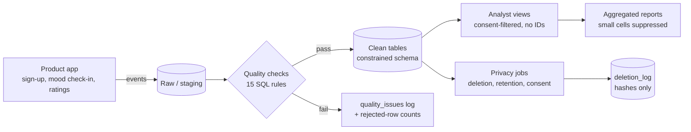

# Data governance plan (draft for MoodBox review)

**Status:** this is a working draft built on synthetic data. Retention periods, roles and tooling are proposals to confirm with MoodBox's founders and technical advisor. Privacy-law obligations (for a Canadian private-sector company, PIPEDA is the likely baseline) should be confirmed with whoever advises MoodBox on legal matters; this document is not legal advice.

## 1. Data flow

## 2. Principles
1. **Collect less.** Age is banded, no postal code, no free-text mood, no raw email in the analytics database.
2. **Purpose limitation.** Data collected for recommendations and product improvement is not reused for other purposes (e.g. advertising, selling datasets) without new, explicit consent. "Potential future commercial use" is the main open question (section 8).
3. **Least privilege.** Each role sees only what its job needs.
4. **Mood is sensitive in practice.** It can reveal emotional or mental state, so it gets the stricter handling even if the law does not strictly require it.
5. **Everything is auditable.** Quality results, deletions and retention runs are logged.

## 3. Access control
| Role | Can do | Cannot do |
|---|---|---|
| app_writer (backend service) | Insert events | Bulk-read users or events |
| pipeline_rw (ETL/quality jobs) | Read/write staging and clean tables | Be used interactively by people |
| analyst_ro (analysts, interns) | Query consent-filtered views | Read `users`, `email_hash`, `user_id` |
| privacy_admin (named person) | Run deletion/retention jobs | Anything unlogged |

`sql/postgres_roles.sql` is a starting template. Review access quarterly; remove access when someone leaves. As an intern I would work as `analyst_ro` by default and request wider access only for a specific task.

## 4. Consent
- Consent is stored per user (`consent_analytics`, `consent_at`) and enforced in the analyst views, so reports cannot accidentally include non-consenting users (test: `test_report_excludes_non_consenting_users...`).
- Withdrawal takes effect immediately in analytics (`privacy.withdraw_consent`) and is logged.
- Consent text should name the purposes (recommendations, product analytics) in plain language. Any new purpose needs fresh consent.

## 5. Retention (proposed values, to confirm)
| Data | Proposal | Mechanism |
|---|---|---|
| Event data (sessions, check-ins, recommendations, ratings) | 24 months, then delete or aggregate | `privacy.purge_older_than()` scheduled monthly |
| User profile | Life of account, deleted on request | `privacy.delete_user()` |
| Aggregated reports (no personal data) | Indefinite | - |
| Logs (`deletion_log`, `quality_issues`) | Indefinite; contain no personal data | - |
| Backups | 30-day rotation, encrypted | See section 7 |

## 6. Deletion requests
1. Verify the requester controls the account.
2. Run `delete_user(user_id)`: hard delete cascades through sessions, check-ins, recommendations and ratings in one transaction.
3. A row is written to `deletion_log` with a one-way hash of the id and row counts (no personal data).
4. Confirm to the user, within the response time MoodBox commits to (confirm the target; PIPEDA expects timely handling).
5. **Backups:** the deleted data remains in backups until they rotate out. If a backup is ever restored, run `reapply_deletions()` straight away (tested in `test_reapply_deletions_after_backup_restore`).

## 7. Secure storage checklist
- [ ] Encryption at rest for the database and backups; TLS in transit.
- [ ] Email hashing salt and DB credentials in a secrets manager, never in the repo (the demo salt in code is a placeholder).
- [ ] Separate dev/test from production; use synthetic or masked data outside production.
- [ ] Automated daily backups with a tested restore, not just a configured backup.
- [ ] Access and deletion jobs logged; alerts on bulk reads of `users`.
- [ ] Minimum cell size (10) before publishing any aggregate; no row-level exports to analysts.
- [ ] Incident plan: who is told, in what order, and how breach assessment/reporting is decided.

## 8. If the data moves to a lakehouse (Delta/Databricks)
Deletion and access control work differently; see `docs/dbt_databricks.md`. In short: keys are not enforced, deletes are not cascaded, a delete is logical until `VACUUM`, and raw tables must be purged as well or a rebuild restores the user.

## 9. Questions I would ask MoodBox on day one
1. What is the current consent flow, and what exactly does it say about analytics and future commercial use?
2. Which third-party tools receive events (analytics SDKs, hosting, email)? Each is a data-sharing path to document.
3. Where does movie metadata come from, and what do its licence terms say about storage and reuse?
4. Is there a user base in Quebec or the EU/UK? That changes consent and rights requirements.
5. Who is the named privacy contact, and what response time has been promised for access/deletion requests?
